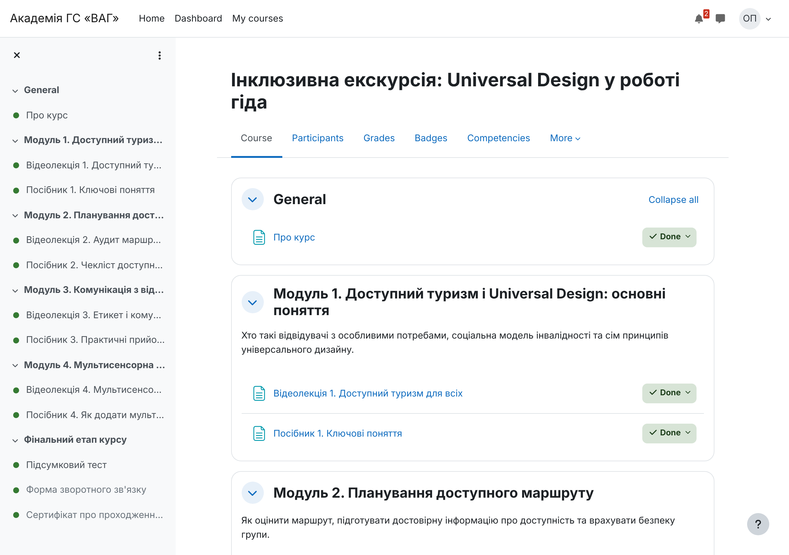

# Академія ГС «ВАГ» — навчальна платформа

Платформа для навчання та підвищення кваліфікації **туристичних гідів** і **працівників сфери гостинності** Громадської спілки «Всеукраїнська асоціація гідів» (ГС «ВАГ», UTGA).

- **Ядро:** Moodle 4.5 LTS (відкрите LMS) + плагін PDF-сертифікатів `mod_customcert`
- **Мова:** українська
- **Підтвердження результатів:** PDF-сертифікат з кодом і QR-кодом + цифровий бейдж **Open Badges 2.0**; обидва перевіряються онлайн без входу в систему
- **Доступність:** WCAG 2.1 AA — обов'язкова вимога
- **Хостинг:** сервер psgua.com (див. [docs/deploy-psgua.md](docs/deploy-psgua.md))



## Статус

| Статус | Елемент | Підтвердження |
|---|---|---|
| 🟢 Перевірено локально | Автоматичне збирання курсів з `courses/*/course.json` (модулі, тест, анкета, сертифікат, бейдж) | `provisioning/provision.php` на Moodle 4.5.15+ / PHP 8.3 / PostgreSQL 16 |
| 🟢 Перевірено локально | Послідовне відкриття модулів; сертифікат лише після тесту (≥ 80%) і анкети | `tests/smoke_learner_journey.php` — усі 11 перевірок (+1 з `--pdf`) для обох курсів |
| 🟢 Перевірено локально | Публічна перевірка сертифіката за кодом / QR без входу | HTTP-запит до `verify_certificate.php` → «Verified» |
| 🟢 Перевірено локально | Бейдж Open Badges 2.0 (hosted assertion: видавець, критерії, дата) | `badges/assertion.php?...&obversion=2` повертає валідний JSON |
| 🟢 Перевірено локально | Автоматичний аудит WCAG 2.1 A/AA (axe-core) 9 ключових сторінок — 0 порушень | `tests/a11y/check.mjs` |
| 🟡 В розробці | Зміст двох курсів — **чернетки** структури й текстів | Потребують затвердження експертами ГС «ВАГ» |
| 🟡 В розробці | Відео (з субтитрами), PDF-посібники | Створює Асоціація; на сторінках — заглушки «Відео готується» |
| 🟡 В розробці | Прив'язка до ESCO | Поля є в `course.json` і у бейджі (alignment), але **URI ще не верифіковані** — не публікуються, доки `uri: null` |
| 🔵 Заплановано | Розгортання на psgua.com | Потрібні відповіді від хостингу — [docs/deploy-psgua.md](docs/deploy-psgua.md) |
| 🔵 Заплановано | Український мовний пакет Moodle | Встановлюється на сервері (у тестовому середовищі був недоступний download.moodle.org) |
| 🔵 Заплановано | Ручний аудит доступності (клавіатура, зчитувач екрана) | Чекліст — [docs/accessibility-wcag21aa.md](docs/accessibility-wcag21aa.md) |
| 🔵 Заплановано | Портал ГС «ВАГ» на React (варіант C) | Після запуску ядра; онлайн-перевірку вже забезпечує Moodle |

> **Важливо:** автоматичний аудит axe-core виявляє лише частину проблем доступності. «0 порушень» ≠ відповідність WCAG 2.1 AA. Відповідність заявляється лише після ручного аудиту.

## Структура репозиторію

```
config/site.json                 налаштування сайту, категорії, видавець бейджів
courses/<курс>/course.json       опис курсу: модулі, активності, тест, сертифікат, бейдж, ESCO
courses/<курс>/questions.gift    запитання підсумкового тесту (формат GIFT)
provisioning/provision.php       збирає/оновлює сайт і курси в Moodle
scripts/install-moodle.sh        завантажує Moodle 4.5 LTS + mod_customcert
scripts/local-dev.sh             локальне середовище (PostgreSQL + вбудований сервер PHP)
scripts/check-server.sh          діагностика хостингу перед встановленням (лише читає)
tests/smoke_learner_journey.php  наскрізний тест шляху слухача (ЛИШЕ локально/staging)
tests/a11y/                      автоматичний аудит WCAG 2.1 A/AA (Playwright + axe-core)
docs/                            архітектура, розгортання, доступність, сертифікати й бейджі, редагування змісту
```

## Швидкий старт (локально)

```bash
scripts/local-dev.sh
```

Перевірка шляху слухача й доступності:

```bash
php -d max_input_vars=5000 tests/smoke_learner_journey.php --moodle=.local/moodle --course=UTGA-G01 --password='Learner#2026'
```

```bash
cd tests/a11y && npm install && A11Y_USER=<username> A11Y_PASS='Learner#2026' COURSE_ID=<id> VERIFY_CODE=<код> BADGE_HASH=<хеш> npm run check
```

(значення `username`, `id`, код і хеш друкує попередня команда)

## Документація

- [Архітектура](docs/architecture.md)
- [Розгортання на psgua.com](docs/deploy-psgua.md)
- [Доступність WCAG 2.1 AA](docs/accessibility-wcag21aa.md)
- [Сертифікати та бейджі](docs/certificates-badges.md)
- [Як редагувати зміст курсів](docs/content-guide.md)

## Ліцензії

Moodle і `mod_customcert` — GNU GPL v3. Код цього репозиторію, що працює всередині Moodle (`provisioning/`, `tests/*.php`), також розповсюджується за GPL v3.
