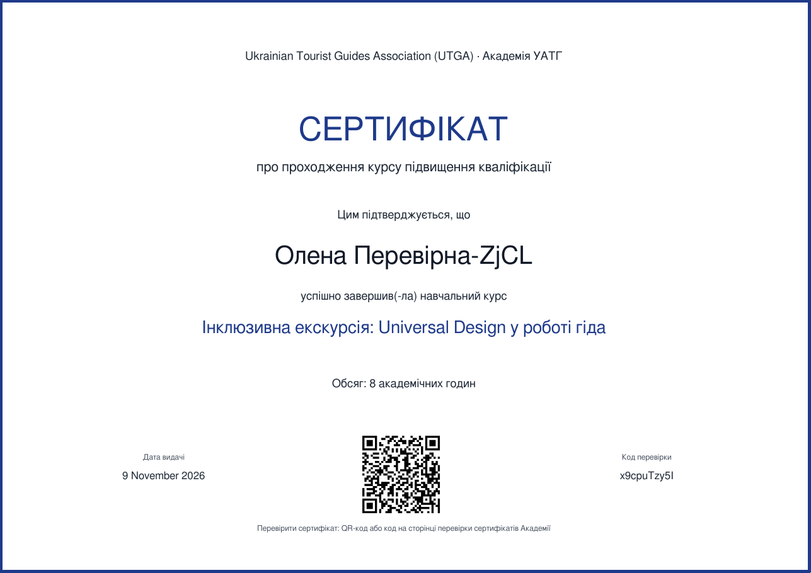
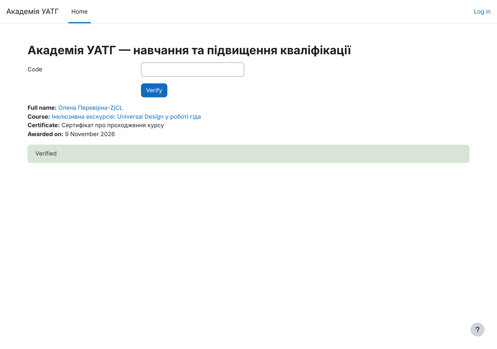

# Сертифікати та бейджі

## PDF-сертифікат (`mod_customcert`)

- **Коли видається:** після складання підсумкового тесту (≥ 80%) і надсилання анкети.
- **Що містить:** назву організації, ім'я слухача, назву курсу, обсяг у годинах, дату видачі, **унікальний код перевірки** і **QR-код**.
- **Перевірка:** будь-хто, без входу в систему, на сторінці
  `https://<домен>/mod/customcert/verify_certificate.php` — ввести код або відсканувати QR-код.
  Показує ім'я, курс, назву сертифіката, дату видачі й статус «Перевірено».
- Шаблон формується автоматично в `provision.php` (`utga_certificate_template`). Його можна змінити й в інтерфейсі (дизайн, логотип, підписи).

## Цифровий бейдж (Open Badges 2.0)

- **Коли видається:** автоматично після завершення курсу (усі матеріали + тест + анкета).
- **Що це:** hosted-підтвердження Open Badges 2.0: JSON на сервері Академії з даними видавця, критеріями отримання й датою. Отримувач ідентифікується хешем email (без відкритої адреси).
- **Перевірка:**
  - публічна сторінка: `https://<домен>/badges/badge.php?hash=<хеш>`
  - машинозчитувана: `https://<домен>/badges/assertion.php?b=<хеш>&obversion=2`
- Слухач може завантажити бейдж (PNG з вбудованими даними) або додати до зовнішнього «рюкзака» (backpack).
- **ESCO:** якщо в `course.json` вказано верифікований `uri`, він додається до бейджа як *alignment* (стандартне поле Open Badges 2.0). Поки `uri: null`, прив'язка не публікується.

## Чесні обмеження

| Обмеження | Наслідок |
|---|---|
| Open Badges **2.0**, а не 3.0 / W3C Verifiable Credentials | Перевірка залежить від доступності сервера Академії (hosted); немає криптографічного підпису. Перехід на OB 3.0 — 🔵 етап 2 |
| Зображення бейджа — тимчасове | Потрібен дизайн від Асоціації (PNG 300×300) |
| Сертифікат не є документом державного зразка | Офіційне визнання підвищення кваліфікації — питання нормативної бази та партнерства, а не платформи |
